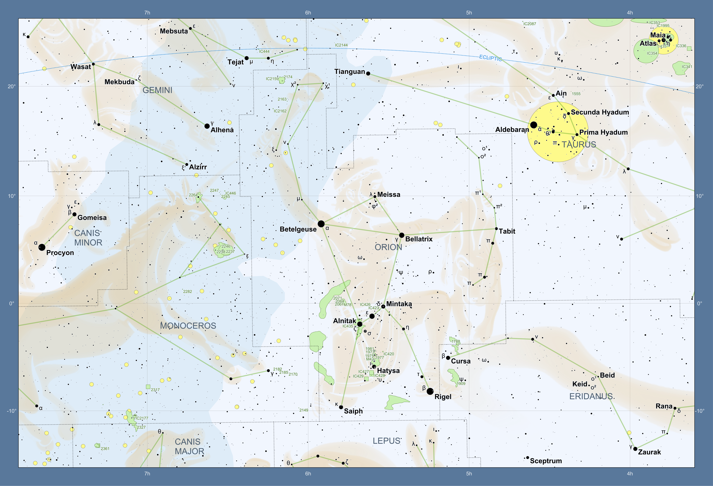
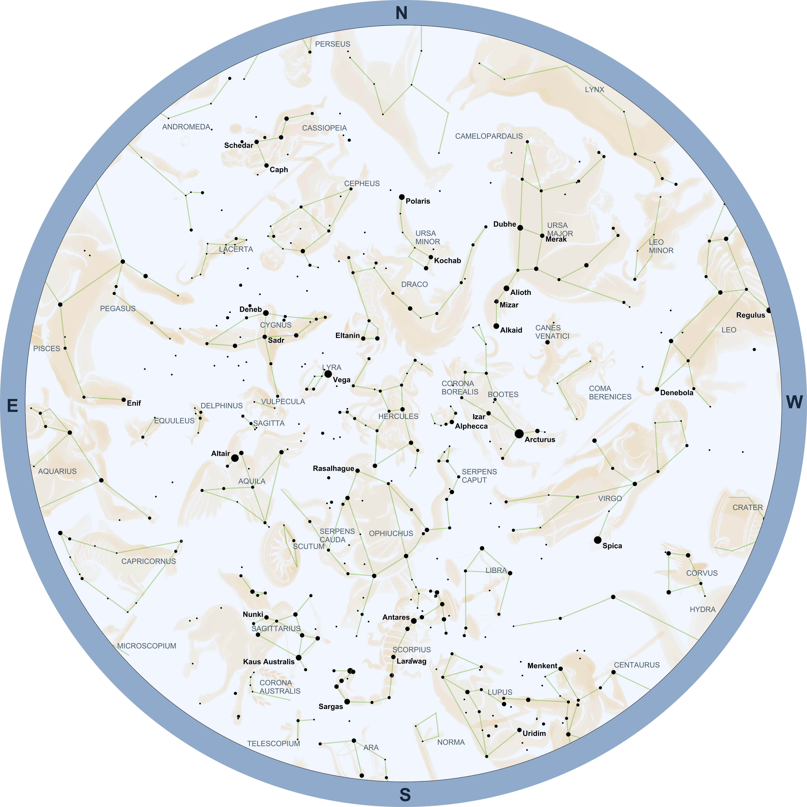

# StarPlot 星座插画扩展

让大熊跃上星空，让猎户现身星图！只需更换绘图类的导入，并增加 `ArtConfig` 配置，即可为 [StarPlot](https://github.com/steveberardi/starplot) 星图添上星座插画，让点与线之间的故事跃然眼前。

- 覆盖全部 88 个星座，使用 Stellarium Modern 原始 PNG。
- 支持 `MapPlot`、`ZenithPlot`、`HorizonPlot`、`GalaxyPlot` 和 `OpticPlot`。
- 自由选择星座、颜色、亮度与透明度，支持 PNG 和 SVG 导出。

当前开发与验证基于 StarPlot 0.21.4。





## 安装

请参考 [StarPlot 安装说明](https://starplot.dev/installation/)，特别留意 PNG 文件导出的相关要求。

## 使用

下载并解压本仓库，将 `constellation_art.py` 和 `src/` 放在绘图脚本旁边，无需单独安装本扩展。

运行示例，生成 `map_orion.png`：

```bash
python run_demo_map_orion_chart.py
```

其他示例为 `run_demo_allsky.py`、`run_demo_horizon.py`、`run_demo_galaxy.py`、`run_demo_optic.py`。全部默认输出 PNG；如需 SVG，修改 export 文件名后缀即可。

在自己的脚本中，从 `constellation_art` 导入绘图类，并增加 `art` 配置，其余操作沿用 StarPlot：

```python
from starplot import Miller, _
from constellation_art import MapPlot, ArtConfig

p = MapPlot(
    projection=Miller(),
    ra_min=54, ra_max=117, dec_min=-15.2, dec_max=26,
    resolution=1600, autoscale=True,
    art=ArtConfig(color="#e4bd7b", opacity=0.7),
)
p.constellations()
p.stars(where=[_.magnitude < 6], where_labels=[False])
p.export("my_chart.png")
```

`ArtConfig()` 默认显示视野内全部插画；设置 `constellations=("Ori", "Tau")` 可仅显示指定星座，`color=None` 则保留原图外观。

代码采用 MIT；Stellarium 插画采用 Free Art License，文字与数据采用 CC BY-SA 4.0。详见 [第三方声明](THIRD_PARTY_NOTICES.md)。

---

# StarPlot Art

Bring the constellations to life—from the Great Bear to Orion! Change the plot-class import and add `ArtConfig` to fill your [StarPlot](https://github.com/steveberardi/starplot) charts with constellation artwork.

- All 88 constellations, using original PNG artwork from Stellarium Modern.
- Supports `MapPlot`, `ZenithPlot`, `HorizonPlot`, `GalaxyPlot` and `OpticPlot`.
- Choose constellations, color, brightness and opacity; export PNG or SVG.

Currently developed and tested with StarPlot 0.21.4. See the Orion preview above.

## Install

Refer to the [StarPlot installation guide](https://starplot.dev/installation/), paying particular attention to the requirements for PNG export.

## Use

Download and extract this repository. Keep `constellation_art.py` and `src/` beside your chart script; no separate extension installation is needed.

```bash
python run_demo_map_orion_chart.py
```

This writes `map_orion.png`. Other examples: `run_demo_allsky.py`, `run_demo_horizon.py`, `run_demo_galaxy.py`, `run_demo_optic.py`. All default to PNG; change the export filename to `.svg` for SVG.

Use the complete Python example above: import the plot class from `constellation_art`, add `art=ArtConfig(...)`, and keep your other StarPlot operations unchanged.

`ArtConfig()` shows all artwork in view. Use `constellations=("Ori", "Tau")` to select specific constellations; `color=None` keeps the original appearance.

Code: MIT. Stellarium artwork: Free Art License. Stellarium text/data: CC BY-SA 4.0. See [THIRD_PARTY_NOTICES.md](THIRD_PARTY_NOTICES.md).
